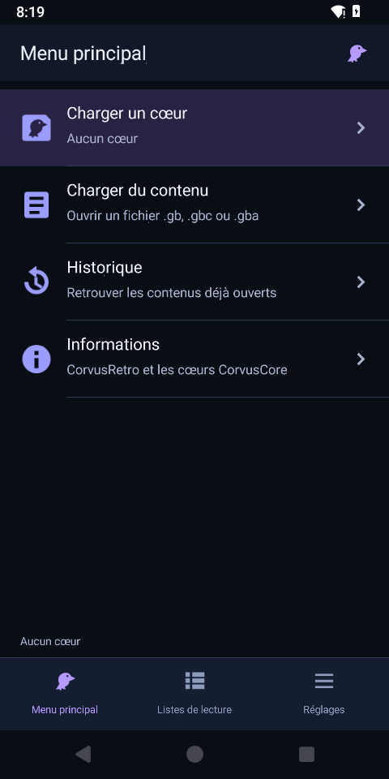
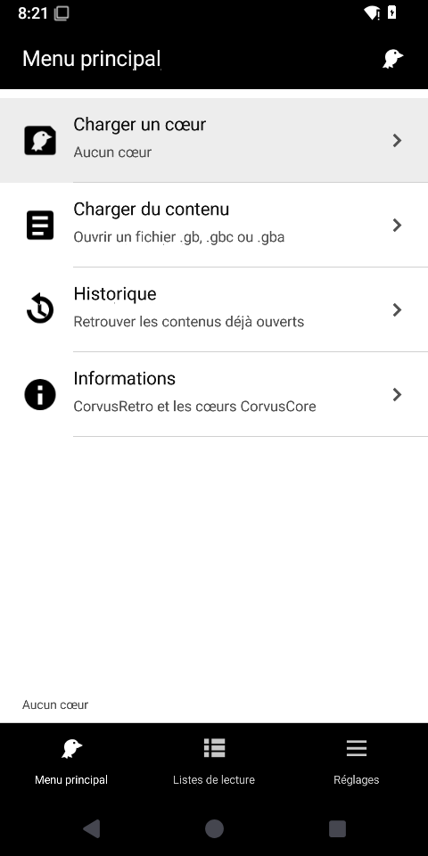
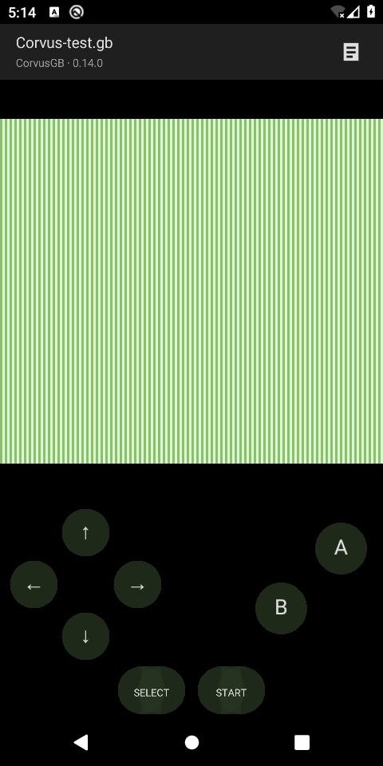

# CorvusRetro

Application Android native originale de **CorvusSoftware**, inspirée de l'approche
C/C++ et de la navigation MaterialUI de RetroArch. Les moteurs sont ceux de
[CorvusCore](https://github.com/CorvusSoftware/CorvusCore), charges via l'ABI
[CorvusAPI](https://github.com/CorvusSoftware/CorvusAPI).
Code applicatif sous **AGPL-3.0-only**, Copyright (C) 2026 CorvusSoftware.

## Version 0.10 : application sans cœurs préinstallés

CorvusRetro 0.10 adopte le comportement d'un frontend libretro : l'application
de base n'embarque aucun émulateur. Les moteurs officiels CorvusGB,
CorvusGBC et CorvusGBA sont sélectionnés pour une **compilation APK de pack**
distincte, destinée au [Téléchargeur de cœurs](docs/core-downloader.md).

L'APK principal peut ouvrir le menu **Charger un cœur > Téléchargeur de cœurs**
sans émulateur présent. Les trois moteurs sont donc optionnels dans l'APK
distribuée ; CorvusCore reste le fournisseur officiel sans être une
dépendance runtime obligatoire pour les utilisateurs.

**Important :** le canal Android actuel fournit des **APK CorvusRetro
complets** mis à jour via PackageInstaller. Un pack remplace l'ensemble
de l'application et les moteurs inclus, sans installer des fichiers
`.so` indépendants et cumulables comme RetroArch. Le catalogue est vide
jusqu'à ce que des APK de release réellement signés soient publiés.
Aucune ROM ou BIOS commercial n'est fourni.

### Construire la base et les moteurs en option

```sh
# APK 0.10 légère, sans CorvusGB, CorvusGBC ni CorvusGBA :
./gradlew :app:assembleDebug

# APK contenant explicitement les trois moteurs officiels :
./gradlew -PcorvusCores=gb,gbc,gba :app:assembleDebug

# Tests natifs : ils utilisent toujours les trois moteurs :
make test
make test SANITIZE=ON
```

Pour une publication officielle, la même clé de signature durable doit
être utilisée pour l'APK de base et les packs. Les consignes sont dans
[core-downloader.md](docs/core-downloader.md). Sans cette étape de
signature et de publication, le catalogue n'est pas encore utilisable
pour télécharger les moteurs.

Le fichier [AGENTS.md](AGENTS.md) et les instructions de répertoire
préparent Codex à travailler sur cette architecture, selon une
organisation inspirée des conventions de développement de RetroArch.

## Historique : version 0.9, appuis et catégories

Les commandes de jeu deviennent plus visibles pendant l'appui, puis reviennent
progressivement au repos. Les menus donnent un retour visuel au toucher : un tap
valide au relâchement, un maintien court sélectionne, et un appui long rétablit
le défaut des réglages booléens concernés.

Les réglages sont regroupés en **Interface utilisateur**, **Vidéo**, **Audio** et
**Affichage à l'écran**. L'historique se trouve dans **Listes de lecture** ;
les informations et licences sont dans **Menu principal > Informations**.
Le retour conserve la sélection et le défilement du parent.
Voir [l'organisation et les références RetroArch](docs/navigation.md).

Le menu de jeu reste au centre, entre **Select** et **Start**. Vidéo proportionnelle,
croix à huit directions, disposition adaptative portrait/paysage et marges Android
restent en place : [commandes](docs/controls.md). Les trois
[thèmes](docs/themes.md) sont CorvusRetro par défaut, NVIDIA Shield et ASUS.

Les menus, leur état, la navigation, les commandes, le rendu et la boucle
d'émulation sont maintenant en **C11**. Une `NativeActivity` héberge la boucle
native ; le rendu passe par **EGL et OpenGL ES 2**, l'audio par **AAudio**.
Les menus et le lecteur Java de la version 0.4 ont été remplacés.

| Partie | Implémentation |
| --- | --- |
| Menus, thèmes, navigation et commandes | C11, `frontend.c` et `play_layout.c` |
| Boucle Android et cycle de vie | C11, `native_main.c` |
| Rendu des menus et des frames | C11, EGL/OpenGL ES 2 |
| Audio PCM stéréo | C11, AAudio et tampon circulaire |
| Chargement, états et batterie | C11, ABI C CorvusAPI et modules integres |
| Moteurs GB/GBC/GBA | C++20, CorvusCore |
| Services du système Android | Java : SAF, stockage/préférences, polices et ressources |

Java ne construit aucun menu et ne fait tourner aucun moteur. Les polices système
et les icônes originales sont rasterisées par le service Android dans un atlas ;
le frontend C compose et dessine le texte et les icônes en OpenGL.
Le cache de glyphes natif accepte aussi les noms de contenus Unicode.

## Fonctions

- Listes tactiles et onglets Menu principal, Listes de lecture et Réglages.
- Chargement d'un cœur sans contenu et déchargement réel, avec état **Aucun cœur**.
- **CorvusGB**, **CorvusGBC** et **CorvusGBA expérimental**, disponibles dans le pack officiel optionnel, version des moteurs 0.14.0.
- Thème **CorvusRetro** bleu nuit/violet par défaut, **ASUS** noir/blanc et **NVIDIA Shield** noir/vert.
- Icônes originales, module de cœur avec une tête de corbeau et identité CorvusRetro.
- Import local par le sélecteur Android, listes par console et historique.
- Commandes tactiles simultanées, croix à huit directions, clavier/manette, audio stéréo et proportions vidéo conservées.
- Menu rapide natif via le bouton central : reprendre, redémarrer, sauvegarder, charger un état, menu principal et fermeture.
- Suspension en arrière-plan et conservation de la session lors d'une rotation.
- APK debug Android 8.0+, ARM64 et x86_64.

<p>
  
  
  
</p>

Autres captures : [réglages](docs/screenshots/settings.png),
[menu rapide](docs/screenshots/quick-menu.png), [lecteur en paysage](docs/screenshots/player-landscape.png),
[catalogue des thèmes](docs/screenshots/themes.png).

## Utilisation et données

L'application démarre avec **Aucun cœur**. **Charger un cœur** prépare une instance
native ; **Décharger le cœur** enregistre la batterie puis libère cette instance.
**Charger du contenu** ouvre le sélecteur système pour un fichier décompressé de
32 Mio au maximum. Le frontend C associe `.gbc` à GBC et `.gba` à GBA ; `.gb`
utilise GB/GBC selon le choix courant, ou GB si GBA était sélectionné.

Les listes peuvent charger directement le cœur associé. Le bouton Retour Android
ouvre ou ferme le menu rapide pendant le jeu. **Menu principal** suspend le jeu
et donne accès aux autres menus ; **Reprendre le contenu** y retourne.
**Fermer le contenu** persiste la batterie et libère le moteur.

Les fichiers privés et l'index des versions 0.3/0.4 sont conservés : contenus,
historique, préférences, batterie et états associés à CorvusCore 0.14.0.
Les écritures de batterie sont atomiques et acquittées auprès du cœur après leur
réussite. Un échec de persistance bloque un remplacement ou déchargement demandé
pour permettre une nouvelle tentative. La batterie est aussi enregistrée à la
pause et périodiquement. Un emplacement d'état est disponible par contenu.

Une mise à jour avec la même signature conserve les données ; une désinstallation
les supprime. L'export des sauvegardes reste à ajouter. La compatibilité dépend
de CorvusCore, GBA reste expérimental et aucun jeu commercial ou BIOS constructeur
n'est fourni.

## Construire et tester

JDK 17 ou 21, SDK Android 35, Build Tools 35.0.0, NDK 27.2.12479018 et CMake 3.22.1.
Gradle 8.13 et AGP 8.9.1 sont fixés.

```sh
git clone --recurse-submodules https://github.com/CorvusSoftware/CorvusRetro.git
cd CorvusRetro
git submodule update --init --recursive
export ANDROID_HOME=/chemin/vers/android-sdk
./gradlew :app:assembleDebug :app:lintDebug
# Tests du frontend C et des vrais moteurs, sur Linux :
make test CMAKE="$ANDROID_HOME/cmake/3.22.1/bin/cmake"
make test SANITIZE=ON CMAKE="$ANDROID_HOME/cmake/3.22.1/bin/cmake"
```

APK : `app/build/outputs/apk/debug/app-debug.apk`, signé avec la clé Android debug.
Les tests hotes n'ont plus besoin d'une JVM ou d'un pont JNI : ils exercent le C,
les modules CorvusAPI et les vrais moteurs directement. Le test mémoire instrumente notre code C portable ; le SDK
CorvusCore n'est pas instrumenté par cette option.
Voir [les preuves et limites Android](docs/validation-android.md).

## APK automatique

Le workflow [Android APK](https://github.com/CorvusSoftware/CorvusRetro/actions/workflows/android.yml)
s'exécute sur `main`, sur les pull requests et manuellement. Il initialise les
sous-modules, contrôle la ponctuation, teste le C et les moteurs avec et sans
sanitizers, construit l'APK, exécute lint et vérifie signature et alignement 16 Ko.

Téléchargement : **Actions → Android APK → exécution réussie → Artifacts →
CorvusRetro-debug-…**. Extraire l'APK du ZIP ; artefacts conservés 14 jours.

## Architecture et origine

`app/src/main/cpp/` contient le frontend C, ses pilotes Android/GL/audio et le
contrat portable de plateforme. `app/src/main/java/` contient uniquement les
services Android. `third_party/CorvusCore/` fournit les moteurs C++20 via un sous-module versionne. Chaque moteur est expose
par un module CorvusAPI integre a l'APK, sans adaptateur libretro. Le frontend
utilise le contrat CorvusAPI version 0, encore experimental, et non directement
l'API C de CorvusCore. Voir [la migration](docs/corvusapi-migration.md).

L'architecture, les pilotes et MaterialUI de RetroArch ont été étudiés. Les
implémentations applicatives, shaders et icônes sont originaux. Voir
[les références](docs/retroarch-reference.md). La colle standard `native_app_glue`
provient du NDK Android et conserve sa notice Apache-2.0 dans l'APK.

Tout fichier source original porte :

```c
// CorvusRetro - CorvusSoftware
// Copyright (C) 2026 CorvusSoftware
// SPDX-License-Identifier: AGPL-3.0-only
```

Les tirets Unicode longs sont interdits dans les fichiers du dépôt parent et
contrôlés par CI. Les licences et attributions de CorvusCore, du NDK et du wrapper
Gradle restent conservées. Elles sont consultables dans **Réglages → Licence et crédits**.
