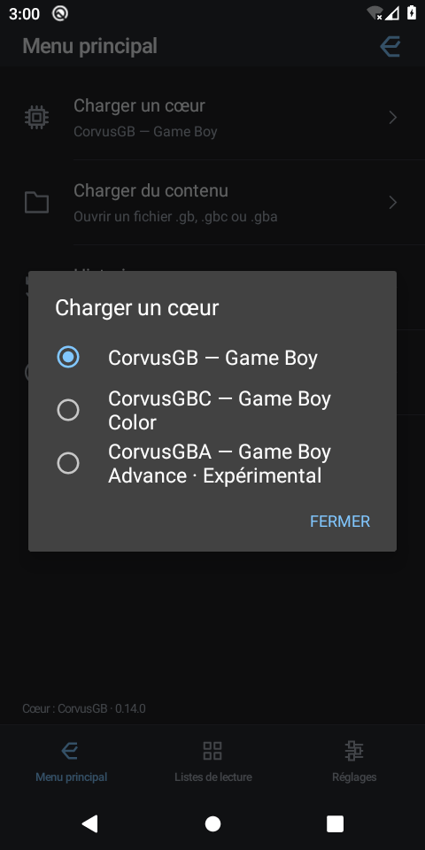

# CorvusRetro

Application Android de **CorvusSoftware**, avec interface originale inspirée de
la navigation **MaterialUI de RetroArch** et les moteurs maison
[CorvusCore](https://github.com/CorvusSoftware/CorvusCore).
Code applicatif sous **AGPL-3.0-only**, Copyright (C) 2026 CorvusSoftware.

## Version 0.3

- Menu principal en listes tactiles : charger un cœur, charger du contenu, historique et informations.
- Onglets Menu principal, Listes de lecture et Réglages ; thème anthracite et bleu.
- Cœurs intégrés **CorvusGB**, **CorvusGBC** et **CorvusGBA (expérimental)**, version 0.14.0.
- Import de fichiers locaux par le sélecteur Android, listes par console et historique.
- Rendu natif à proportions conservées, audio PCM stéréo et commandes tactiles.
- Menu rapide : reprendre, redémarrer, sauvegarder/charger un état et fermer le contenu.
- Sauvegardes batterie automatiques ; arrêt de l'émulation en arrière-plan.
- APK debug pour Android 8.0+ : ARM64 et x86_64.

La compatibilité dépend de CorvusCore ; l'intégration ne garantit pas que tous les
jeux fonctionnent. GBA reste expérimental. Aucun jeu commercial ou BIOS constructeur n'est fourni.

Captures sur émulateur Android 10 :

<p>
  
  
  
</p>

Autres captures : [liste de contenus](docs/screenshots/playlist.png),
[menu rapide](docs/screenshots/quick-menu.png), [réglages](docs/screenshots/settings.png).

## Utilisation

1. Choisir éventuellement un cœur dans **Charger un cœur**.
2. Utiliser **Charger du contenu** pour sélectionner un fichier `.gb`, `.gbc` ou `.gba`.
3. Retrouver le contenu dans **Listes de lecture** ou **Historique**.
4. Pendant le jeu, ouvrir le **Menu rapide** avec son icône ou le bouton Retour Android.

L'extension `.gbc` ou `.gba` sélectionne le système correspondant. Un fichier `.gb`
utilise le cœur GB/GBC choisi ; avec GBA sélectionné, il revient au cœur GB.
Les fichiers doivent être décompressés, avec une taille maximale de 32 Mio.
L'import vérifie le contenu avec le cœur avant de l'ajouter à la bibliothèque.

Les contenus sont copiés dans le stockage privé de l'application. Les sauvegardes
batterie sont écrites périodiquement, à la pause et à la fermeture. Un emplacement
d'état par contenu est associé à la version de CorvusCore. Les données sont conservées
lors d'une mise à jour avec la même signature et supprimées à la désinstallation.
L'export de sauvegardes n'est pas encore proposé.

Les touches directionnelles, A/B, Start/Select et L/R sur GBA sont tactiles.
Les événements clavier/manette Android correspondants sont aussi pris en charge
(flèches, Z/X, Entrée/Espace, boutons A/B, Start/Select et L1/R1).
Le son et la veille se règlent avant le lancement d'un contenu.

## Construire

Prérequis : JDK 17 ou 21, Android SDK 35, Build Tools 35.0.0,
NDK 27.2.12479018 et CMake 3.22.1. Gradle 8.13 et AGP 8.9.1 sont fixés.

```sh
git clone --recurse-submodules https://github.com/CorvusSoftware/CorvusRetro.git
cd CorvusRetro
# Pour un clone existant :
git submodule update --init --recursive
export ANDROID_HOME=/chemin/vers/android-sdk
./gradlew :app:assembleDebug :app:lintDebug
```

Résultat : `app/build/outputs/apk/debug/app-debug.apk`.
Dans Android Studio, ouvrir la racine puis installer ces versions du SDK/NDK/CMake.
L'APK utilise la signature Android de développement, pas une clé de publication.

## APK automatique

Le workflow [Android APK](https://github.com/CorvusSoftware/CorvusRetro/actions/workflows/android.yml)
s'exécute à chaque push sur `main`, pour les pull requests et manuellement.
Il initialise CorvusCore, exécute les tests C et JNI, les contrôles mémoire,
la compilation et lint Android, puis vérifie la signature et l'alignement 16 Ko.

Téléchargement : **Actions → Android APK → exécution réussie → Artifacts →
CorvusRetro-debug-…**, puis extraire l'APK du ZIP. Artefacts conservés 14 jours.

## Architecture et tests

```text
app/                      Menus Android Java, lecteur, audio et pont JNI C++
third_party/CorvusCore/    Moteurs C++20 et SDK C, sous-module figé
core/                     Ancienne démo portable C11 (réglages → Démo de rendu)
tests/                    Tests C et tests Java/JNI exécutables sur Linux
```

`MainActivity` gère menus/imports ; `PlayerActivity` héberge le lecteur.
`EmulationSession` sérialise l'émulation, l'audio et les sauvegardes sur un thread
dédié. `NativeCore` utilise le SDK C de CorvusCore via JNI : images ARGB8888,
audio PCM16 stéréo, entrées, états et sauvegardes batterie avec acquittement
après écriture. Le thread Android présente les images et reçoit les commandes.

CorvusCore est fixé au commit `38829d4935bbdcf4b13261714352362065b78551`.
Son API C version 0 est encore préliminaire ; toute mise à jour exige une nouvelle
validation du pont. Les sources du sous-module restent intactes.

```sh
make test
# Sous Linux, JAVA_HOME doit désigner un JDK complet :
make jni-test
make core-jni-test CMAKE="$ANDROID_HOME/cmake/3.22.1/bin/cmake"
```

Les tests JNI des vrais moteurs utilisent des programmes synthétiques originaux
pour GB, GBC et GBA : chargement, image, audio, entrées, états, reset, rejet des
buffers invalides et sauvegarde batterie GBA. Ils n'établissent pas la compatibilité
avec un catalogue de jeux. Voir [la validation Android](docs/validation-android.md)
pour les interactions réellement vérifiées et les limites restantes.

## Inspiration et licences

La navigation reprend les principes étudiés dans le pilote MaterialUI de RetroArch :
listes d'actions, trois onglets et menu rapide. Le code applicatif, les icônes et
les commandes sont écrits pour CorvusRetro. Aucun code ou graphisme RetroArch
n'est copié. Le lecteur utilise directement le SDK CorvusCore, sans frontend libretro.
Voir [les références et choix d'intégration](docs/retroarch-reference.md).

Tout fichier source original porte :

```c
// CorvusRetro - CorvusSoftware
// Copyright (C) 2026 CorvusSoftware
// SPDX-License-Identifier: AGPL-3.0-only
```

Les fichiers XML et scripts adaptent les commentaires à leur langage. Les licences
et crédits tiers sont conservés : wrapper Gradle, CorvusCore et ses attributions
internes. Les notices CorvusCore sont également consultables hors ligne dans
**Réglages → Licence et crédits**.
