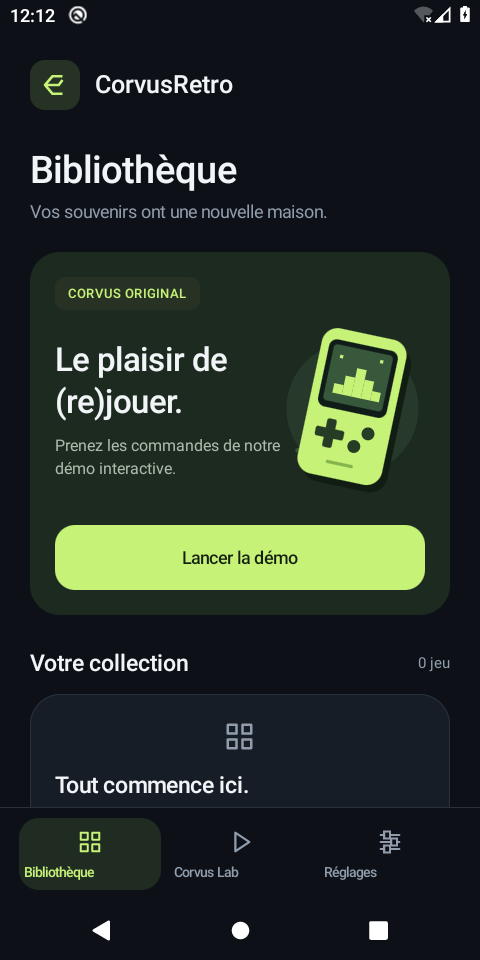
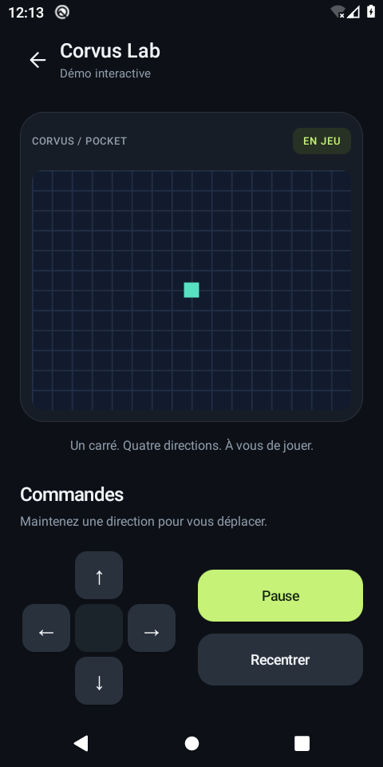
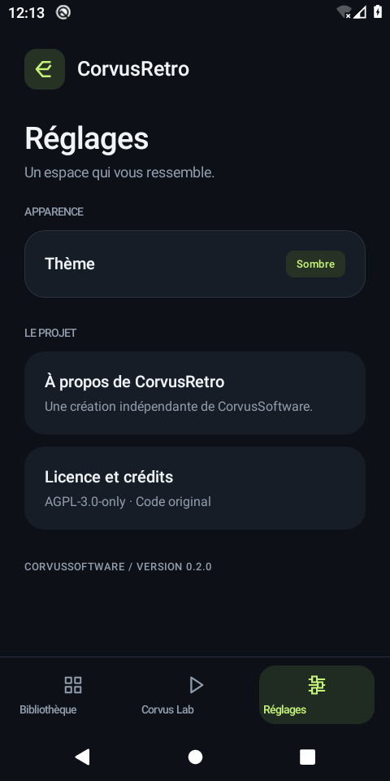

# CorvusRetro

Application mobile rétro originale de **CorvusSoftware**, Android d'abord.
Code original sous **AGPL-3.0-only**, Copyright (C) 2026 CorvusSoftware.

## Version 0.2 : bibliothèque et laboratoire

- Bibliothèque avec état vide explicite, cartes arrondies et navigation inférieure.
- Interface anthracite et citron, icônes et illustration vectorielle originales.
- Réglages avec informations du projet et licence consultable hors ligne.
- Laboratoire séparé avec démo native C sur une grille 256 × 192.
- Commandes directionnelles tactiles, pause/reprise et réinitialisation.
- Arrêt de la boucle d'affichage lorsque l'application passe en arrière-plan.
- APK de développement pour Android 8.0+ : ARM64 et x86_64.

Cette première base **n'émule aucune console**. Elle n'importe pas de ROM, de BIOS
ou de cœur externe et ne produit pas encore de son.

Captures réelles sur émulateur Android 10 (480 × 960) :

<p>
  
  
  
</p>

## Architecture

```text
app/   Bibliothèque/réglages, laboratoire Java/Canvas, pont JNI et packaging
core/  État et rendu C11 portable, sans dépendance Android
tests/ Tests du noyau exécutables sur ordinateur
```

`MainActivity` affiche la bibliothèque et les réglages ; `GameActivity` héberge
la démo et sa croix directionnelle. Le moteur ne tourne pas dans la bibliothèque.
L'interface transmet un masque de boutons au noyau via JNI. Le noyau avance d'un
pas puis fournit une image ARGB. Toutes les opérations Android/JNI restent sur
le thread d'interface ; le noyau n'alloue aucune mémoire dynamique.
La démo utilise un pas par tick d'environ 16 ms, sans promesse de timing d'émulation.

## Construire

Prérequis : JDK 17 ou 21, Android SDK 35, Build Tools 35.0.0 et NDK 27.2.12479018.
Le wrapper vérifie le SHA-256 de Gradle 8.13 ; le plugin Android est fixé à 8.9.1.

```sh
export ANDROID_HOME=/chemin/vers/android-sdk
./gradlew :app:assembleDebug :app:lintDebug
```

Résultat : `app/build/outputs/apk/debug/app-debug.apk`.
Depuis Android Studio, ouvrir le dossier racine, installer ces versions du SDK/NDK
via le gestionnaire SDK et lancer `app` sur un appareil ARM64 ou un émulateur x86_64.
L'APK debug utilise la signature de développement Android, pas une clé de publication.

## Construction automatique sur GitHub

Le workflow **Android APK** s'exécute à chaque push sur `main`, sur les pull requests
vers `main` et manuellement depuis l'onglet **Actions**. Il exécute les tests C,
les contrôles mémoire, le test JNI, la compilation Android et lint, puis vérifie
la signature et l'alignement 16 Ko de l'APK.

Pour télécharger l'application : ouvrir **Actions → Android APK → une exécution
réussie → Artifacts → CorvusRetro-debug-…**, puis extraire l'APK du ZIP.
Les artefacts sont conservés 14 jours. Aucune clé de publication ni aucun secret
de signature n'est nécessaire pour cette version de développement.

## Tester

```sh
make test
make clean
make test CFLAGS='-std=c11 -Wall -Wextra -Werror -pedantic -g -fsanitize=address,undefined'
# Linux, avec JAVA_HOME pointant vers un JDK complet :
make jni-test
```

Les tests couvrent les déplacements, les entrées opposées, les limites, la pause,
le reset, les pixels ARGB et les buffers insuffisants.

La version 0.2 a également été exercée sur un émulateur Android 10 : navigation,
licence, lancement de la démo, direction maintenue, absence de mouvement en pause,
recentrage, arrière-plan/reprise avec conservation de la pause et retour Android.
Les captures ci-dessus proviennent de cette exécution. Un téléphone physique,
TalkBack et le multitouch simultané n'ont pas été testés.

Sur appareil : maintenir chaque direction, atteindre les quatre bords, mettre en
pause, reprendre, réinitialiser, changer d'orientation, passer en arrière-plan
puis revenir. La recréation de l'activité réinitialise volontairement la démo.

## Inspiration et origine

Le [README officiel de RetroArch](https://github.com/libretro/RetroArch) décrit
un frontend et des cœurs portables C/C++. Nous reprenons cette idée de séparation,
avec un noyau C11 et une coque Android Java/JNI écrits pour CorvusRetro.
Aucun code, graphisme ou cœur de RetroArch n'est inclus. L'API actuelle est
interne à CorvusRetro et ne prétend pas être compatible avec libretro.

Tout nouveau fichier source original porte :

```c
// CorvusRetro - CorvusSoftware
// Copyright (C) 2026 CorvusSoftware
// SPDX-License-Identifier: AGPL-3.0-only
```

Les fichiers XML et scripts utilisent la syntaxe de commentaire de leur langage.
Le wrapper Gradle généré conserve ses mentions et sa licence d'origine ; le texte
de licence standard n'est pas réattribué à CorvusSoftware.

## Suite proposée

1. Bibliothèque locale et sélection de contenus avec le sélecteur système Android.
2. Contrat de cœur d'émulation, timing, audio et entrées manette.
3. Premier système émulé maison, choisi et testé séparément.
4. Sauvegardes, réglages et port iOS autour du noyau portable.
